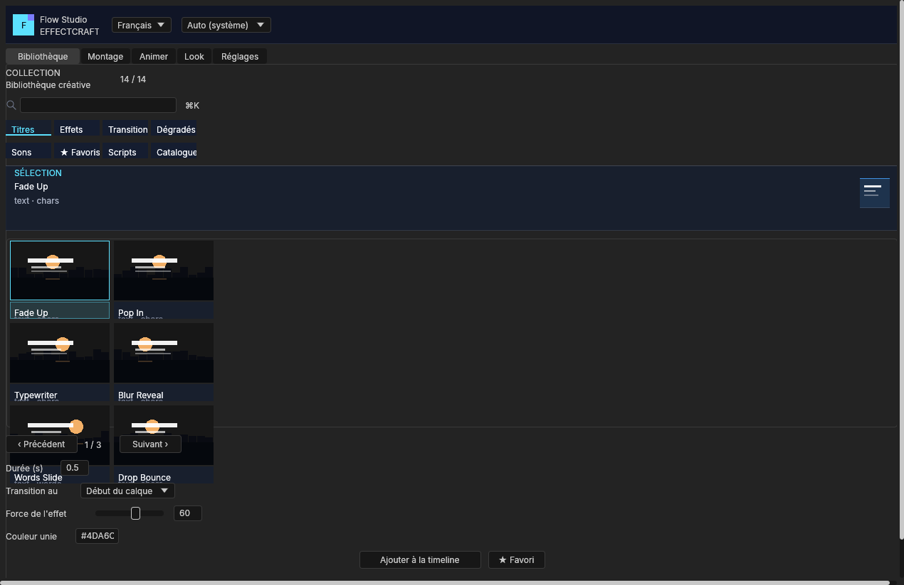

# Flow Studio

**An open-source editing panel for [EffectCraft](https://getartcraft.com/apps/effectcraft): silence cutting, Whisper captions, karaoke, beats, sound effects, text animations and AE scripts — in French, English and Arabic.**

Flow Studio is a ScriptUI panel that installs into EffectCraft's `Scripts/ScriptUI Panels` folder. It adds five tabs — **Library**, **Montage**, **Animer**, **Look** and **Réglages** — and a small optional local helper for the work a script cannot do alone: speech-to-text, silence detection, WAV generation and model management.

- **Panel only.** It never rebuilds or replaces EffectCraft.
- **Offline by default.** Models are downloaded only when you ask for them.
- **Panel install and resize verified on EffectCraft 0.22.0** (Windows 11). See [Limits](#limits) for what was not tested.
- **License: MIT OR Apache-2.0.** Based on EffectCraft by the ArtCraft team; this is an independent project, not an ArtCraft product.



## Install

### Windows

1. Download or clone this repository:

   ```sh
   git clone https://github.com/Mohameddhiab/effectcraft-flow-studio.git
   cd effectcraft-flow-studio
   ```

2. Double-click **`INSTALL-PANEL.bat`**.
3. Restart EffectCraft.
4. Open **Window ▸ Flow Studio.jsx**.

The installer copies only `extensions/scriptui-panels/Flow Studio.jsx` into
`%APPDATA%\EffectCraft\Scripts\ScriptUI Panels\` and keeps the previous panel as
`Flow Studio.jsx.<date>.bak`. It does not build, download or modify the application.
Set `EFFECTCRAFT_CONFIG_DIR` to install into a custom config folder.

### macOS / Linux

```sh
sh flow-install/install.sh
```

Then restart EffectCraft and open **Window ▸ Flow Studio.jsx**.

The panel is installed in:

- **macOS:** `~/Library/Application Support/EffectCraft/Scripts/ScriptUI Panels/`
- **Linux:** `~/.config/effectcraft/Scripts/ScriptUI Panels/` (or `$XDG_CONFIG_HOME/effectcraft/...`)

### First run

In EffectCraft, open **Settings ▸ Scripting & Expressions** and enable **Allow Scripts to Write
Files and Access Network**. The welcome screen then offers **Vérifier le helper** and **Continuer
sans helper**.

Prefer a ZIP? Download **`flow-studio-panel.zip`** from the latest release.

## What it does

| Tab | Screens | Highlights |
|---|---|---|
| **Library** | Unified browser | 499 validated presets (titles, text animations, transitions, effects, gradients, palettes, captions, sounds, tools) plus the legacy generators, audio, favorites and AE scripts, in a 2-column drawn-thumbnail grid, with kind/family filters, search, live preview and favorites. |
| **Montage** | Silence | Live waveform with red cut zones, green speech and a threshold line; advanced detector settings; ripple or marker modes; tempo detection and beat cuts. |
| **Montage** | Captions | Whisper speech-to-text, 8 built-in caption styles, word-by-word **karaoke** (Hormozi, Word Pop, highlight), SRT/VTT import, SRT and **ASS** export, Arabic RTL placement. |
| **Montage** | Sounds | 20 original synthesised sound effects, instant playhead insertion and custom folder scanning. |
| **Animer** | Ease | 37 easing curves with an onDraw preview, applied to selected properties or intro animations. |
| **Animer** | Expressions | Searchable expression library with parameter sliders and a code view. |
| **Animer** | Text | 10 modular text animators, custom presets and JSON import/export. |
| **Look** | Background | 10 animated linear/radial/4-colour gradients, custom presets and live updates. |
| **Look** | Effects | 16 expression-driven video effects with strength, timing and easing. |
| **Look** | Stroke | Stroke plug-in integration (`org.effectcraft.example.stroke`). |
| **Réglages** | Models | Whisper model manager with licence, source and checksum information. |
| **Réglages** | Helper & Aide | Setup guide, permissions reminder, connection diagnostic and **Réessayer**. |
| **Réglages** | Pack Presets | Export/import caption styles, text animations, backgrounds and panel settings in one JSON file. |

### Interface

- **Five top tabs, thirteen leaf screens.** Every leaf screen has exactly one primary action; the
  welcome screen has one primary action and one secondary escape.
- **Responsive layout.** Rows, fields, sliders and grids fill the available width; there are no fixed
  panel widths, only minimum sizes. The Library grid is 3 × 2 and the caption-style grid is 4 × 2.
- **Status and progress.** Green for success, orange for warnings, red for failures; helper jobs draw
  a real progress bar driven by the helper's progress messages.
- **Theme and language.** The header switches between **Français**, **English** and **العربية**, and
  between **Auto**, **Sombre** and **Clair**. The choice persists across sessions.
- **Persisted state.** Last top tab, library category, silence settings, advanced mode, language,
  theme and helper port are saved in the host preferences.

## Optional helper

Silence, Captions, Sounds, Models and the Library's Audio category use a local helper on
`127.0.0.1:9890` (`effectcraft-flow-helper serve`). The visual Library (titles, effects, transitions,
generators and AE scripts), Ease, Expressions, Text, Background, Effects and Stroke work without it.

The helper source is included as an overlay:

- `overlay/crates/flow` — pure Rust core: audio, silence, captions, styles, karaoke, beats, packs,
  models and synthesised sound effects.
- `overlay/apps/flow-helper` — the JSON-lines helper and its one-shot commands.

To build it, copy the two folders into an EffectCraft source checkout that has the Flow Studio
workspace entries, then run:

```sh
cargo build --release -p effectcraft-flow-helper
target/release/effectcraft-flow-helper serve
```

Open **Réglages ▸ Helper & Aide** and click **Réessayer** after starting it. The helper listens on
loopback only and writes its data under `FlowStudio` next to EffectCraft's settings.

## Architecture

```
Flow Studio.jsx  ── JSON lines, 127.0.0.1:9890 ──►  effectcraft-flow-helper
   ScriptUI panel                                  ├─ overlay/crates/flow (pure logic)
   public scripting API only                       └─ effectcraft-media (audio decode)
```

The panel lives in `Scripts/ScriptUI Panels`, which an EffectCraft update does not replace. It uses
only the public scripting API: `app.run`, `Socket`, ScriptUI and expressions. The helper writes only
inside its `FlowStudio` folder and never listens on a public interface.

## Compatibility

- **EffectCraft 0.22.0** (Windows MSI) was used for the live check: the panel opens from
  `%APPDATA%\EffectCraft\Scripts\ScriptUI Panels`, and after a resize to 760 × 540 the tabbed area
  measured 474 px with the status row visible at 516–532.
- EffectCraft 0.22 sends `scriptui.resize` with `size: [w, h]`; the development fork uses
  `{width, height}`. The panel accepts both, and its `onResize` shim pins the tabbed area to the pane
  height when the host does not share a column's spare height.
- ScriptUI cannot recolour native controls. The theme repaints custom-drawn previews, waveforms,
  curves and thumbnails; buttons, fields and tabs keep the host colours.

## Tests

- **194-check smoke suite** (`flow-install/tests/smoke-test.jsx`) covering the welcome screen, five
  top tabs, one primary action per leaf screen, English/Arabic switching, dark/light themes, library
  grid and paging, eight style thumbnails, pack round-trip, ASS karaoke tags, beat markers, AE
  scripts and Arabic RTL captions. It passed **194 / 0** in the development fork.
- **`cargo test -p effectcraft-flow`** covers the pure Rust core (47 tests); the helper and ScriptUI
  resize regression tests are part of the development fork.
- The screenshots in `docs/images` are original offscreen renders of EffectCraft/Flow Studio with an
  empty generated project and no third-party media.

See [`docs/flow-studio.md`](docs/flow-studio.md) for the full feature and testing notes.

## Limits

- A real Whisper model, real transcription and the Stroke plug-in were not available in the test
  environment; the helper and panel were exercised headlessly and the panel once in the real 0.22
  GUI (open + resize, no editing session).
- Arabic needs a font with Arabic glyphs (the *Arabic Clean* preset asks for *Noto Sans Arabic*);
  shaping depends on EffectCraft's text engine.
- Silence cutting duplicates the kept sections into new layers; no footage is re-encoded.

## License and credits

Flow Studio is released under **MIT OR Apache-2.0** (see `LICENSE-MIT` and `LICENSE-APACHE`).

It is based on [EffectCraft](https://github.com/storytold/effectcraft), copyright the ArtCraft team
and the EffectCraft contributors, also MIT OR Apache-2.0. The ArtCraft name and logos are trademarks
of the ArtCraft team; they are **not** included in this repository. This project is not affiliated
with, endorsed by or sponsored by the ArtCraft team.

The sound effects are synthesised by `overlay/crates/flow/src/sfx.rs`; no third-party samples are
bundled. The screenshots are original renders of the panel. See [`ATTRIBUTION.md`](ATTRIBUTION.md).

## Contributing

Issues and pull requests are welcome. Keep changes small, follow the host's never-crash rules (no
`unwrap`, `expect`, `panic` or `unsafe` in non-test code), and run the smoke suite before opening a
pull request. The panel is a single ScriptUI file; the Rust core and helper live in `overlay/`.

## Français

Flow Studio est un panneau open source pour EffectCraft : découpe des silences, sous-titres Whisper,
karaoké, rythme, bruitages, animations de texte et scripts AE, en français, anglais et arabe.

**Installation (Windows) :** double-clique **`INSTALL-PANEL.bat`**, redémarre EffectCraft, puis ouvre
**Window ▸ Flow Studio.jsx**. L'installeur ne touche pas à l'application et sauvegarde l'ancien
panneau en `.bak`.

**macOS / Linux :** `sh flow-install/install.sh`.

Le helper est optionnel : sans lui, Ease, Expressions, Text, Background, Effects, Stroke et la
bibliothèque visuelle (titres, effets, transitions, générateurs, scripts AE) fonctionnent. Silence,
Captions, Sounds, Models et la catégorie Audio demandent `effectcraft-flow-helper serve` (source dans
`overlay/`).

Licence **MIT OR Apache-2.0**. Projet indépendant, basé sur EffectCraft ; les marques ArtCraft ne
sont pas incluses et ce projet n'est ni affilié ni approuvé par l'équipe ArtCraft.
