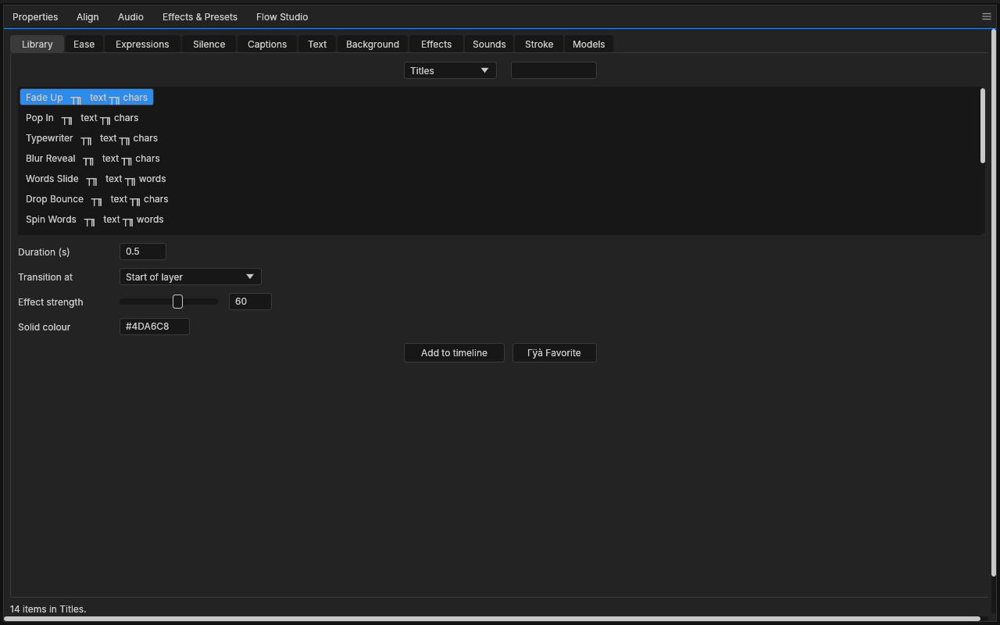
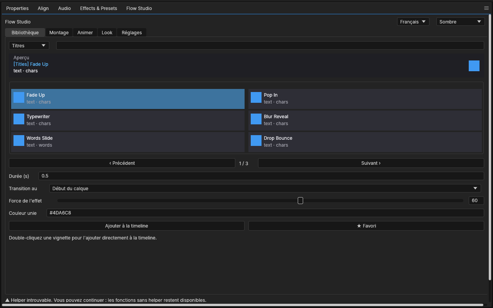
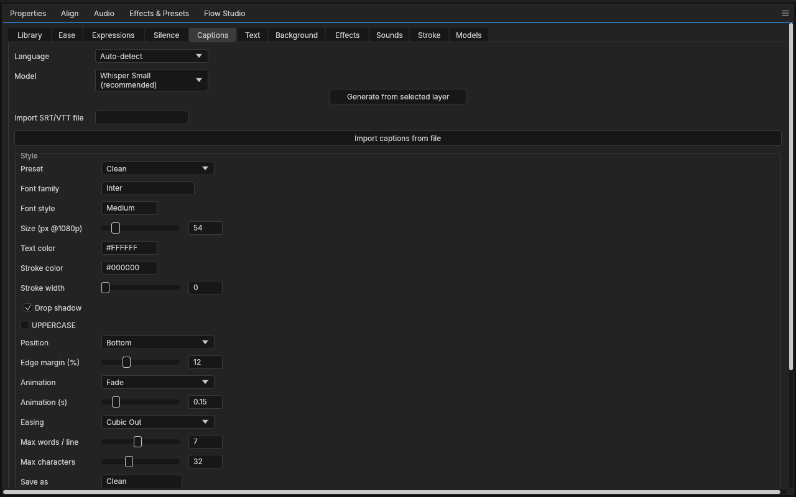
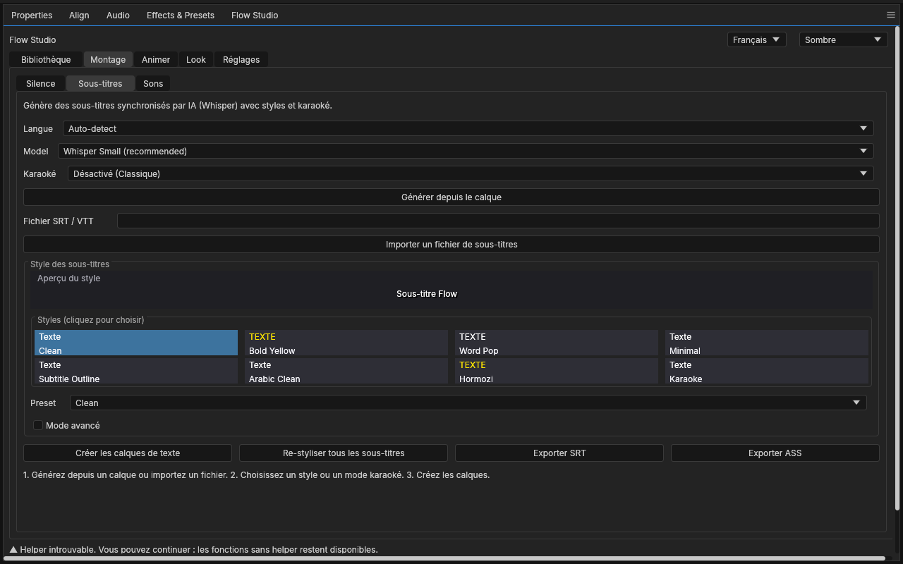

# Flow Studio

One dockable panel (**Window ▸ Flow Studio.jsx**) organized into 5 clear categories, plus a small local helper
for the parts a script can't do itself. Everything is open source and runs offline after the models are downloaded.
The interface ships in **French, English and Arabic**, follows the host light/dark theme (or a forced theme),
and opens on a short welcome screen the first time.

## Installing

- **Panel only (EffectCraft is already installed).** Run `INSTALL-PANEL.bat` (Windows) or
  `flow-install/install.sh` (macOS/Linux). It copies just `Flow Studio.jsx` into the host's
  `Scripts/ScriptUI Panels` folder, keeps the previous file as a `.bak`, and never builds or touches
  the application. Restart EffectCraft, then open **Window ▸ Flow Studio.jsx**. The helper is optional:
  without it, Ease, Expressions, Text, Background, Effects and Stroke work; Silence, Captions, Sounds
  and Models need `effectcraft-flow-helper serve`.
- **Helper (optional).** Build it from `overlay/` in an EffectCraft source checkout:
  `cargo build --release -p effectcraft-flow-helper`, then run
  `target/release/effectcraft-flow-helper serve`. The panel works without it for Ease, Expressions,
  Text, Background, Effects and Stroke; the visual Library also works, but its Audio category needs
  the helper.
- **Older hosts.** The panel runs on EffectCraft 0.22 as well as on the development fork. If the host
  does not share a column's spare height, the panel pins the tabbed area to the pane height on resize
  so the status line and the bottom of each screen stay visible.

| Category | Sub-tabs | What it does |
|---|---|---|
| **Library** | Unified browser | Titles, Effects, Transitions, Generators, Audio, Favorites and AE Scripts in a 2-column thumbnail grid (6 per page), with search, live preview and favorites. |
| **Montage** | Silence | Finds silences with a live waveform (red cut zones, green speech, threshold line), advanced detector settings and ripple/marker modes. |
| | Captions | Whisper speech-to-text, editable caption styles with 8 thumbnails, word-by-word **karaoke** (Hormozi, Word Pop, highlight), SRT/VTT import, SRT and **ASS** export. |
| | Sounds | 20 original synthesised sound effects with instant playhead insertion and custom folder scanning. |
| **Animer** | Ease | 37 easing curves with an onDraw preview, applied to selected properties or intro animations. |
| | Expressions | Searchable expression library with parameter sliders and a code view. |
| | Text | 10 modular text animators, custom presets and JSON import/export. |
| **Look** | Background | 10 animated linear/radial/4-colour gradients, custom presets and live updates. |
| | Effects | 16 expression-driven video effects with strength, timing and easing. |
| | Stroke | Stroke plug-in integration (`org.effectcraft.example.stroke`). |
| **Réglages** | Models | Whisper model manager, licence/source info and checksum verification. |
| | Helper & Aide | Setup guide, permissions reminder, connection diagnostic and **Réessayer**. |
| | Pack Presets | Full preset-pack export/import: caption styles, text animations, backgrounds and panel settings in one JSON file. |

### Interface behaviour (v3)

- **Five top tabs, thirteen leaf screens.** Each leaf screen has exactly one primary (accent) action; the
  welcome screen also has exactly one primary action and one secondary escape.
- **Welcome screen.** Shown once. It offers **Vérifier le helper** (retries in place on failure) and
  **Continuer sans helper**; the workspace and status line stay hidden while it is open. A **Show welcome
  screen** button in *Réglages ▸ Helper & Aide* brings it back.
- **Responsive layout.** Rows, fields, sliders and grids use `alignment = ["fill", …]` with
  `preferredSize`/`minimumSize` floors; there are no fixed panel widths, only minimums. The Library grid
  is 3 rows × 2 columns and the caption-style grid is 4 × 2. A tabbed panel's preferred height follows the
  tab it shows, and a docked panel's `fill` rows share the width the fixed ones leave.
- **Status and progress.** The status line uses green for success, orange for warnings and red for
  failures; helper jobs draw a real progress bar driven by the helper's progress messages.
- **Theme and language.** The header has a language menu (`Français`, `English`, `العربية`) and a theme
  menu (`Auto`, `Sombre`, `Clair`). The choice persists across sessions. Static shell labels, hints and
  buttons are translated; dynamic status/action messages and model information stay in the language the
  action produced.
- **Persisted state.** Last top tab, last library category, silence settings, advanced mode, language,
  theme and helper port are saved in the host preferences.

### ScriptUI layout and drawing notes

- A docked panel fills its pane, and a tab that needs more room grows the window (the pane scrolls).
  When the pane size changes, the host sends `scriptui.resize` (`{window, width, height}` or
  `{window, size: [w, h]}` depending on the EffectCraft version): the script lays
  the window out again, reruns every `onDraw` and fires `onResize`, so previews, waveforms and thumbnail
  grids always paint at their real size.
- `onDraw` replaces the native panel frame and title, so a titled preview draws its own label. Every shape
  starts with `g.newPath()`: `fillPath` / `strokePath` do not clear the current path, and reusing it
  bleeds one shape's outline into the next.
- In a column, `fill` children share the height the fixed ones and the gaps leave (a tabbed panel takes
  the window's spare height, a status row stays at the bottom). In a row they share the width. On hosts
  that only use preferred heights, `onResize` pins the tabbed panel to the pane height (see the
  compatibility note under Installing).

## Before / after

| v1 | v3 |
|---|---|
|  |  |
|  |  |

More v3 screens: [welcome](images/flow-studio-after-welcome.png) · [silence](images/flow-studio-after-silence.png) ·
[preset pack](images/flow-studio-after-pack.png). The captures come from the ignored
`flow_studio_panel_snapshot` test (offscreen, empty project).

## Common AE Scripts (in Library ▸ AE Scripts)
- **Auto Nulls**: Creates a Null object centered on selected layers and parents them to it.
- **Text Exploder**: Splits a text layer into individual word layers.
- **Trim Path**: Adds animated trim paths to shape layers.
- **Anchor Snap**: Snaps the anchor point to bounding-box center without moving the layer in the comp.
- **Bounce**: Applies an inertia overshoot bounce expression to selected properties.
- **Sequence Layers**: Staggers selected layers with a configurable time offset.

## Architecture

```
Flow Studio.jsx  (ScriptUI panel, Scripts folder)      overlay/crates/flow           (L1, pure, 47 tests)
   │  loopback JSON lines, 127.0.0.1:9890                 audio · silence · captions · style · stt · models
   ▼                                                      beats · karaoke · pack · sfx
effectcraft-flow-helper (overlay/apps/flow-helper, L6)  ──uses──►  effectcraft-media (decodes any footage audio)
   │ runs: whisper-cli (whisper.cpp, MIT) · curl (model download)
   ▼
<settings>/FlowStudio/{models, styles, exports, work, config.json, model-pins.json}
```

* The panel uses only the public scripting API (`app.run`, `Socket`, ScriptUI, expressions). It
  lives in `Scripts/ScriptUI Panels`, which an EffectCraft update never replaces.
* The helper writes only inside the `FlowStudio` folder next to EffectCraft's settings, and
  listens on 127.0.0.1 only.
* Add an expression: add one entry to `LIBRARY` in the panel. Add an easing: one `add(...)` line
  in `EASINGS`. Add a new screen: a new `add("tab", …)` block inside the right category.


## Set up

1. Copy `overlay/crates/flow` and `overlay/apps/flow-helper` into an EffectCraft source checkout,
   then `cargo build --release -p effectcraft-flow-helper`.
2. Run `install.sh` or `install.ps1` from `flow-install/`, then restart EffectCraft.
3. Preferences ▸ Scripting & Expressions ▸ **Allow Scripts to Write Files and Access Network**
   (the panel needs it to reach the helper).
4. Start the helper: `effectcraft-flow-helper serve` (port 9890; `--port N` to change, and set the
   same port in the Models tab).
5. For captions, install `whisper-cli` from [whisper.cpp](https://github.com/ggml-org/whisper.cpp)
   (MIT), put it on your PATH or set its path in the Models tab, then install a model there.
   `Whisper Small` is the recommended default.

## Models and checksums

Models are never bundled. The catalog (`overlay/crates/flow/src/models.rs`) lists each model's licence,
author, source and size. **No SHA-256 digests are pinned in this build**, so the helper uses
*trust on first use*: the first install records the file's SHA-256 in `model-pins.json` and every
later **Verify** (or reinstall) must match it. To pin an official digest, copy the
64-character SHA-256 shown on the model's Hugging Face page into the `sha256` field of the
catalog entry; a pinned digest is then checked on every install.

## Silence, captions, karaoke and beats

- **Silence** (`Montage ▸ Silence`): analyses the selected audio or video layer and draws its waveform
  with silent zones in red, speech in green and the threshold as an orange line. **Analyser les silences**
  fills the result, then **Couper les silences** either ripples the kept sections or only places markers.
  Sensitivity, minimum silence, padding, detector and the advanced threshold are persisted.
- **Captions** (`Montage ▸ Captions`): **Générer depuis le calque** transcribes the selected layer with
  Whisper; **Importer un fichier de sous-titres** accepts `.srt` and `.vtt`; **Exporter SRT** and
  **Exporter ASS** write to the helper's exports folder. The style editor has a live swatch, font,
  colours, stroke, shadow, position, animation and grouping controls. Eight built-in styles ship with
  the panel: Clean, Bold Yellow, Word Pop, Minimal, Subtitle Outline, Arabic Clean, Hormozi and Karaoke.
- **Karaoke**: the Karaoke menu offers *Hormozi (yellow pop)*, *Word Pop (scale)* and
  *Karaoke (highlight)*. The panel asks the helper for a per-word timing plan (`karaoke.plan`) and builds
  real text layers with scale/position/highlight expressions. **Exporter ASS** switches to
  `ass_karaoke` automatically when a karaoke mode is active, so the file carries `{\kNN}` tags.
- **Arabic / RTL**: when the caption text is Arabic, the panel right-justifies the paragraph and anchors
  the caption to the right edge, so mixed French/Arabic projects keep their reading direction.
- **Beats** (`Montage ▸ Silence`, rhythm panel): **Détecter le tempo** runs `beats.analyze`, reports the
  BPM and places beat markers; **Couper sur le tempo** cuts the selected layer on those beats.

## Preset packs

**Réglages ▸ Pack Presets** exports one JSON document with `schema`, `app`, `text`, `backgrounds`,
`captionStyles` and `settings`. **Exporter le pack complet** writes the file through `pack.save`
(inside the helper's exports folder) and shows its path and JSON. **Importer un pack** validates and
imports it through `pack.import`; **Charger ce fichier** loads a path typed in the field. Imports are
hostile input: the helper caps file size, array lengths and item JSON, and the panel re-cleans every
text/background entry and clamps settings before applying them. Built-in caption styles ship with the
panel and are not duplicated into packs; user styles, text animations and backgrounds are.

## Library, text, background, effects and sounds

- **Library** (first tab): one place, like DaVinci Resolve's Effects Library. Categories Titles, Effects,
  Transitions (18), Generators, Audio, Favorites and AE Scripts; search box; 2-column grid with six items
  per page and a pager; double-click or **Add to timeline**; **★ Favorite**.
  Titles land at the playhead with their animation; effects go on the selected layers (or a new adjustment layer
  when nothing is selected); transitions go on the start/end of the selected layers (overlap two clips and put
  a transition on the top one); generators land at the playhead (gradients at the bottom); audio adds sounds at
  the playhead or sets levels (fade in/out, -12 dB, +6 dB, mute) on the selected layers.
- **Text**: 10 built-in text animations (letters, words or lines) plus your own. Pick one, edit any field
  (start state, easing, duration, softness, random order), then **Save as my preset**. My presets are stored
  in the app settings (survive updates); **Export/Import** moves them as JSON. Each animation is a real text
  animator with a range selector driven by an eased expression, named `Flow: <name>`.
- **Background**: 10 gradients (linear, radial, 4-colour) with optional motion (rotate, pulse, drift), your own
  presets, **Add background** (comp-sized solid at the bottom) and **Update selected**.
- **Effects**: 16 effects built from EffectCraft's own effects (Shake, Zoom Punch, Flash, Strobe, Glow Pop,
  Blur In/Out, Fade In/Out, Pixel Reveal, Glitch, Old Film, Teal & Orange, Heat Wave, Echo Trail, Vibrance Pop),
  with strength, duration, start (layer start / playhead / layer end) and easing. All named `Flow: …`.
- **Sounds**: 20 original sound effects synthesised by `overlay/crates/flow/src/sfx.rs` (no samples, no licence needed),
  written as WAV files into `<settings>/FlowStudio/sfx`. Add at the playhead or at the start of each selected
  layer. Famous branded/meme sounds are other people's recordings and are not bundled: put the ones you own in
  a folder and use **Scan my folder**.


## Command line

```
effectcraft-flow-helper silence clip.mp4 --db -35 --min-silence 0.4
effectcraft-flow-helper transcribe clip.mp4 --model whisper-small --lang fr --out clip.srt
effectcraft-flow-helper models
effectcraft-flow-helper install whisper-small
effectcraft-flow-helper request '{"op":"styles.list"}'
effectcraft-flow-helper request '{"op":"beats.analyze","path":"music.wav"}'
effectcraft-flow-helper request '{"op":"karaoke.plan","lines":[...],"options":{"preset":"hormozi"}}'
```

The helper speaks one JSON request per line on 127.0.0.1:9890. The panel uses `silence.analyze`,
`silence.apply`, `captions.transcribe`, `captions.load`, `captions.export` (`srt`, `vtt`, `ass`,
`ass_karaoke`), `styles.list/save/delete`, `beats.analyze`, `karaoke.plan`, `pack.export`,
`pack.save`, `pack.load`, `pack.import`, `models.*`, `ping`, and the sound/model operations.

## Tests and verification

- In the development fork with the overlay applied, `cargo test -p effectcraft-flow` covers the pure
  Rust core (silence, captions/SRT/VTT/ASS, styles, beats, karaoke plans, packs, models, sfx);
  `cargo test -p effectcraft-flow-helper` covers the helper operations; and
  `cargo test -p effectcraft-engine --lib scriptui` covers the ScriptUI layout engine (row/column fill,
  active-tab preferred size). `cargo test -p effectcraft-script` covers ScriptUI events, including the
  pane-resize redraw (**128 tests**). The app-level changes and these tests live in the development
  fork; this repository ships the panel, the overlay and the smoke suite.
- `flow-install/tests/smoke-test.jsx` drives the real panel in EffectCraft through
  `effectcraft-cli`: **194 checks**, including the welcome screen, five top tabs, one primary action
  per leaf screen, English/Arabic switching, dark/light themes, library grid and paging, eight style
  thumbnails, pack file round-trip, ASS karaoke tags, beat markers, AE scripts and Arabic RTL captions.
  Run `scripts/build_steps.ps1`, start the helper, then run the steps with `effectcraft-cli run`
  (see `scripts/run_smoke_test.ps1`).
- The visual record is produced by the ignored `flow_studio_panel_snapshot` test in the development
  fork's `crates/ui-egui/tests/it/ui_scriptui.rs` (set `FLOW_SNAPSHOT_DIR` to write PNGs).
- **Panel-only install checked in the real installed app:** EffectCraft 0.22.0 (MSI) was started with
  `--control 9877`; the panel opened from `%APPDATA%\EffectCraft\Scripts\ScriptUI Panels`, and after
  `scriptui.resize` to 760×540 the tabbed area measured 474 px with the status row visible at
  516–532. This is the compatibility path `INSTALL-PANEL.bat` uses when the app is already installed.

## Limits and untested areas

* Silence cutting makes one duplicated layer per kept section (no footage is re-encoded) and
  disables the original, or removes it if you untick *Keep the original*.
* Captions are text layers with expression-driven animation. Word-by-word highlight and pop-ups are supported via the Karaoke dropdown (Hormozi, Word Pop, and Highlight).
* Arabic needs a font with Arabic glyphs installed (the *Arabic Clean* preset asks for
  *Noto Sans Arabic*); whether shaping is correct depends on EffectCraft's text engine. The ScriptUI
  shell itself stays left-to-right; RTL applies to caption text and placement.
* ScriptUI cannot recolour native controls. The theme repaints the panel's custom-drawn previews,
  waveform, curve and thumbnails, while buttons, fields and tabs keep the host colours. The
  `isPrimary` flag is semantic metadata for tests/agents; the host draws native buttons.
* **Untested in this environment:** a real Whisper model and real transcription (no network/model
  download), the Stroke plug-in (not installed), and audio/video media beyond the generated test
  fixtures. The helper and panel were exercised headlessly and the panel once in the real 0.22 GUI
  (open + resize, no editing session); the screenshot test renders the panel offscreen.
* The Stroke tab was written against the plug-in's published parameters (Stroke Color, Thickness,
  Blur, Softness); it reports a clear error if the effect isn't installed.
